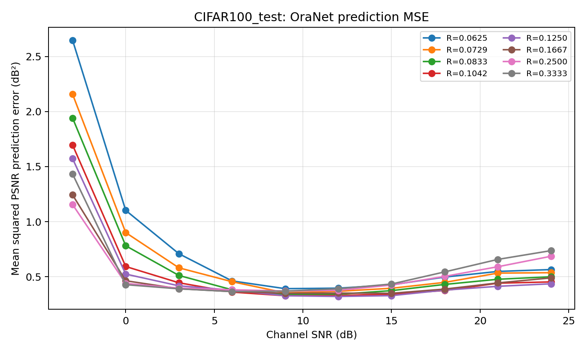
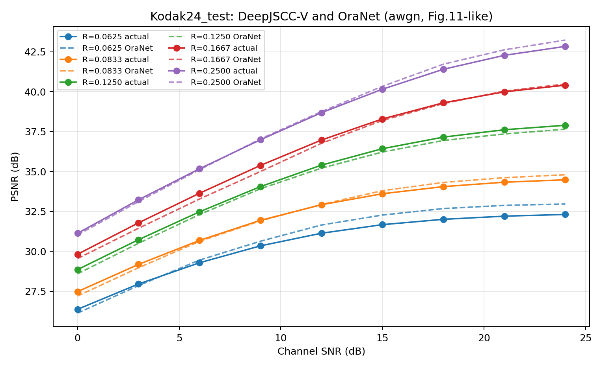
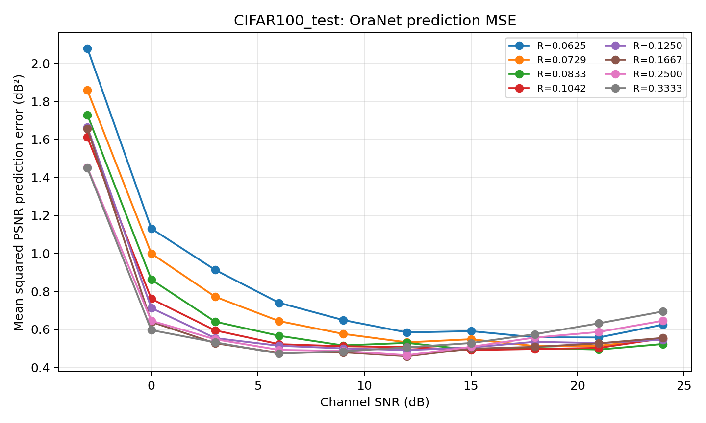

# PADC: DeepJSCC-V & OraNet

**Unofficial, research-oriented reproduction** of:

> W. Zhang *et al.*, “Predictive and Adaptive Deep Coding for Wireless Image Transmission in Semantic Communication,” *IEEE Transactions on Wireless Communications*, vol. 22, no. 8, 2023. **[DOI: 10.1109/TWC.2023.3234408](https://doi.org/10.1109/TWC.2023.3234408)**

**Original PyTorch implementation:** [wyzhang-ustb/Predictive-and-Adaptive-Deep-Coding-for-Wireless-Image-Transmission-in-Semantic-Communication](https://github.com/wyzhang-ustb/Predictive-and-Adaptive-Deep-Coding-for-Wireless-Image-Transmission-in-Semantic-Communication)

This repository provides **Google Colab notebooks**, saved **AWGN / repository-style fading** evaluation plots, reproducibility instructions, and a place to link **pretrained checkpoints hosted separately on Hugging Face**. The encoder/decoder, GDN and OraNet architectures are obtained from the authors' upstream repository at runtime, rather than vendored here.

> **Not an official implementation or author-endorsed release.** Some implementation choices are adapted for Colab and numerical evaluation. Graphs labeled *paper-like* or *PADC-only* must not be interpreted as exact replications of every original figure. Please cite the original paper.

## Contents

### Structure of this repository

The following notebooks serve as starting points:

- **[`01_PADC_AWGN_Colab.ipynb`](notebooks/01_PADC_AWGN_Colab.ipynb)** — full training and evaluation for **AWGN**: CIFAR10 DeepJSCC-V and OraNet, optional ImageNet 128×128 fine-tuning and Kodak24 evaluation; includes the supplemental PADC-only figure cells.
- **[`02_PADC_Fading_Colab.ipynb`](notebooks/02_PADC_Fading_Colab.ipynb)** — the corresponding pipeline for the **`repo_fading` implementation mode**. Uses channel-specific checkpoints and outputs; **not yet independently verified as an exact mathematical slow-Rayleigh baseline**.
- **[`03_CIFAR_Reaudit.ipynb`](notebooks/03_CIFAR_Reaudit.ipynb)** — **no retraining**; reads existing CIFAR evaluation grids, checks Fig. 7(a)-style PSNR prediction MSE, Fig. 5-style data-level CR choice, and separates achievable targets from inherently infeasible ones. Change `EXPERIMENT_DIR` to your run folder.

The notebooks use the following modules and auxiliary files:

- **Authors' `models.py`, `GDN.py`, `OracleNet.py`** — loaded from the **original repository** by the training notebooks; the upstream architecture is **not copied into this repository**. Pinned reference SHA: `2b5fae05f1194189a97e478be21be1e2ae6d4c18`.
- **[`scripts/collect_checkpoints.py`](scripts/collect_checkpoints.py)** — stages `*_best.pt` weight pairs for an external model host and writes SHA-256 checksums.
- **[`results/awgn/`](results/awgn/)** and **[`results/repo_fading/`](results/repo_fading/)** — **real figures and manifest summaries from the supplied runs**, not simulated example plots.
- **[`checkpoints/README.md`](checkpoints/README.md)** — checkpoint naming, paired model selection and download placeholders.

### Pretrained weights

This repository does not store `.pt` checkpoint binaries. Model weights are hosted separately on Hugging Face:

- **[Hugging Face: PADC-DeepJSCCV-OraNet-Reproduction](https://huggingface.co/sclee0724/PADC-DeepJSCCV-OraNet-Reproduction)** — expected model repository ID from the publication setup.
- **[Checkpoint naming, loading and verification](checkpoints/README.md)**.

> **Verify the URL before publishing this README.** This model-repository name was proposed during setup, but its actual visibility and uploaded files could not be independently checked. If you created the model under another name, replace the URL here and in `checkpoints/README.md`. A private model repository will not be accessible to public GitHub visitors.

`*_last.pt` files are meant for **optimizer-state training resume**. The notebooks do not currently provide a separately tested weights-only evaluation workflow: **do not claim that downloading `best.pt` and choosing “Run all” will skip training**. See [reproduction instructions](docs/REPRODUCTION.md).

## Results (provided checkpoints; not re-executed during packaging)

| Dataset / PSNR prediction metric | AWGN | `repo_fading` |
|---|---:|---:|
| CIFAR100 OraNet MAE (dB) | 0.550 | 0.612 |
| CIFAR100 OraNet MSE (dB²) | 0.586 | 0.688 |
| Kodak24 OraNet MAE (dB) | 0.377 | 0.288 |
| Kodak24 OraNet MSE (dB²) | 0.245 | 0.132 |

These are derived from `results/*/metrics_summary.json`. CIFAR100 uses the 10,000-image test set. A low prediction error is **not** a proof of per-image target-PSNR feasibility or satisfaction. See [limitations](docs/LIMITATIONS.md).

**CIFAR100 OraNet PSNR-prediction MSE — AWGN**

**Kodak24 tested versus predicted PSNR — AWGN**

**CIFAR100 OraNet PSNR-prediction MSE — `repo_fading`**

See [all figure files and their reproduction status](docs/FIGURE_STATUS.md). **Full per-image CSV grids and the original results ZIP archives are not tracked in Git; publish them as separate release assets only after review.**

## Quick start: train and reproduce in Colab

1. Open [`01_PADC_AWGN_Colab.ipynb`](notebooks/01_PADC_AWGN_Colab.ipynb) or [`02_PADC_Fading_Colab.ipynb`](notebooks/02_PADC_Fading_Colab.ipynb) in **Google Colab**, and select a GPU runtime.
2. Mount Google Drive. Set `DATA_ROOT` to a path with `cifar-10-batches-py/`, `cifar-100-python/`, `kodak24/`, and (optionally) `imagenet-1k/data/validation-*.parquet`. If the datasets belong to a shared Google Drive folder, add an accessible shortcut under My Drive and verify that Colab can list the directory.
3. Set `PROFILE='paper'` to reproduce full scheduled training, `RUN_JSCC_TRAIN` / `RUN_ORACLE_TRAIN` to select training, and an **unused `RUN_FOLDER`** to start a new run; reusing the same folder **resumes from existing checkpoints**. `smoke` is for functional testing only.
4. For ImageNet→Kodak24, configure `RUN_IMAGENET_FINETUNE=True`, `IMAGENET_DIR`, and `RUN_KODAK_EVALUATION=True`. Training results and data caches are written to your **personal Drive** run folder; original datasets are read-only inputs.
5. Review `results/`, then optionally run [`03_CIFAR_Reaudit.ipynb`](notebooks/03_CIFAR_Reaudit.ipynb) on the saved CIFAR CSVs.

More details: [REPRODUCTION.md](docs/REPRODUCTION.md) · [MODIFICATIONS.md](docs/MODIFICATIONS.md) · [LIMITATIONS.md](docs/LIMITATIONS.md).

## Which paper figures are reproduced?

The experiments cover core PADC behavior, **not all independent baselines**. Fig. 4 & 5 have **DeepJSCC-V-only** counterparts, Fig. 7 includes an AWGN OraNet MSE plot, and Fig. 11–13 include Kodak prediction/CR studies. The repo also includes a supplemental CWM/CWSTD Fig. 6-style analysis. **ADJSCC and BPG+LDPC comparative curves are not provided.** Fig. 9 one-channel ablation is not promoted as a verified result due to a discrepancy; see [figure matrix](docs/FIGURE_STATUS.md).

## What was changed from the authors' GitHub?

This is **not** a simple re-upload of the authors' code. The architecture comes from the authors; the notebook workflows adapt data handling, Colab execution, channel simulation, training resumes, image-resolution handling, feature extraction, CR bookkeeping and evaluation caching. The full list is in **[MODIFICATIONS.md](docs/MODIFICATIONS.md)**. Differences are disclosed rather than silently treated as upstream behavior.

## Attribution, license and citation

- **Primary credit:** Wenyu Zhang and coauthors; [original paper](https://doi.org/10.1109/TWC.2023.3234408) and [original source repository](https://github.com/wyzhang-ustb/Predictive-and-Adaptive-Deep-Coding-for-Wireless-Image-Transmission-in-Semantic-Communication).
- **License status:** no standalone upstream LICENSE file was visible at the upstream root during review. This project deliberately does not vendor upstream model code or grant any license over the authors' work. Confirm rights to distribute adapted code/weights. No license is implicitly granted merely by making this repository public.
- **Datasets:** ImageNet, CIFAR and Kodak image files are **not distributed** in this repository. Check source terms for redistributing any image-based figures.
- **Trust boundary:** PyTorch `.pt` checkpoints can contain Python pickled objects; only load trusted artifacts and verify hashes.
- **Citation:** [`docs/CITATION.md`](docs/CITATION.md).
